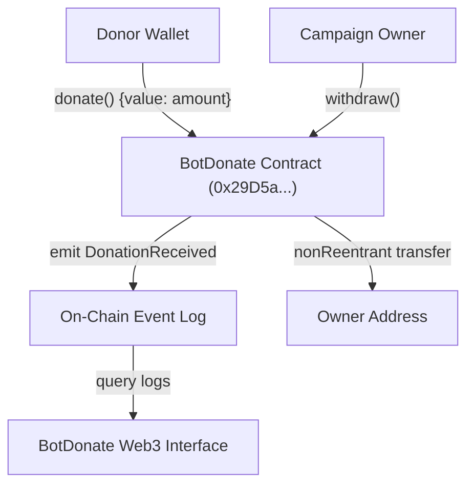

# BotDonate: Technical Whitepaper & Pitch Deck

**Decentralized, Transparent & Direct Native BOT Crowdfunding Protocol**  
**Ecosystem:** Botchain Mainnet (Chain ID: `677`)  
**Contract Address:** `0x29D5a96794889793B4f4b00c010c16e76DF39C50`  
**Explorer:** [https://scan.botchain.ai/address/0x29D5a96794889793B4f4b00c010c16e76DF39C50](https://scan.botchain.ai/address/0x29D5a96794889793B4f4b00c010c16e76DF39C50)  
**Date:** October 2026  
**Document Version:** 1.0.0  

---

## Part 1: Executive Whitepaper

### 1. Abstract
Traditional online donation platforms suffer from opacity, high platform cuts (typically 5%–12%), delayed settlement windows, and opaque accounting. **BotDonate** is an open-source, non-custodial decentralized application (dApp) built natively on Botchain Mainnet. It provides direct peer-to-contract donations in native **BOT**, non-fungible auditability via on-chain `DonationReceived` events, zero intermediary fees, and reentrancy-guarded owner withdrawals.

---

### 2. The Problem
1. **Opaque Intermediaries**: Donors rarely have cryptographic proof that their funds reached the designated project without deductions.
2. **High Platform Fees & Delays**: Traditional processors (and wrapped token bridges) levy hefty transaction and currency conversion fees while holding balances in centralized escrow for days or weeks.
3. **Fabricated Social Proof**: Centralized fundraising websites can easily simulate or manipulate donor numbers and amounts.
4. **Poor Web3 User Experience**: Many decentralized crowdfunding tools are overly complex, requiring multi-step token approvals (ERC-20 allowances) that confuse mainstream users and increase gas costs.

---

### 3. The BotDonate Solution
- **Native BOT Transactions**: Eliminates the ERC-20 `approve()` friction. Users send native BOT directly in a single atomic transaction.
- **Pure On-Chain Transparency**: The user interface queries live `DonationReceived` event logs directly from Botchain RPC (`https://rpc.botchain.ai`). No centralized database or backend can fabricate donor records.
- **0% Platform Take-Rate**: 100% of donated capital arrives at the smart contract, available directly for the project owner to withdraw.
- **Enterprise-Grade Security**: Built using Solidity `^0.8.24` and OpenZeppelin's battle-tested `ReentrancyGuard`.
- **Integrated Chain Experience**: Automatic detection of Chain ID `677`, one-click network adding/switching, and instant transaction hash validation against Botchain Explorer.

---

### 4. Technical Architecture & Smart Contract Design

#### 4.1 System Overview

#### 4.2 Security Primitives
* **ReentrancyGuard**: Prevents reentrancy exploits during owner fund transfers using the checks-effects-interactions pattern.
* **Custom Errors**: Utilizes custom Solidity errors (`ZeroOwnerAddress`, `ZeroDonationAmount`, `NotCampaignOwner`, `NoBalanceToWithdraw`, `TransferFailed`) to minimize bytecode size and reduce gas consumption during failed operations.
* **Immutable Ownership**: The campaign owner address is declared `immutable`, preventing unauthorized administrative modifications post-deployment.

---

## Part 2: Investor & Community Pitch Deck (10-Slide Structure)

### Slide 1: Cover
* **Title:** BotDonate
* **Subtitle:** The Transparent Native Donation Protocol for Botchain
* **Tagline:** Direct. Verifiable. Zero-Middleman Crowdfunding.
* **Network:** Botchain Mainnet (Chain ID: `677`)
* **Live Contract:** `0x29D5a96794889793B4f4b00c010c16e76DF39C50`

---

### Slide 2: The Problem
* Centralized platforms charge 5%–12% in fees and hold funds for up to 30 days.
* Traditional Web3 donation tools require multi-step ERC-20 allowances and complex token wrapping.
* Donors have no cryptographic guarantee of how much was raised or where funds went.

---

### Slide 3: The Solution
* **BotDonate**: A plug-and-play, single-transaction donation portal for Botchain communities.
* Donors send native BOT in 1 click.
* 100% of funds go directly to the verified campaign contract.
* All stats and donor history are verified in real time on the Botchain Explorer.

---

### Slide 4: Market Opportunity
* The global digital crowdfunding market exceeds **$17 Billion** and is projected to surpass **$30 Billion by 2030**.
* Layer-1 and Layer-2 ecosystems require native tooling for public goods funding, hackathon awards, and developer grants.
* BotDonate serves as the fundamental public-goods primitive for the Botchain ecosystem.

---

### Slide 5: Product Walkthrough
* **Campaign Dashboard:** Live metrics displaying total BOT donated, total contributors, and campaign goals.
* **Quick-Donate Interface:** One-click presets (1 BOT, 5 BOT, 25 BOT) + custom input.
* **On-Chain Donor Wall:** Real-time event log display showing donor address, timestamp, and contribution size.
* **Owner Portal:** Automated wallet detection unlocking safe, one-click fund withdrawals.

---

### Slide 6: Technology Stack
* **Smart Contracts:** Solidity `^0.8.24`, Hardhat, OpenZeppelin.
* **Network:** Botchain Mainnet (`https://rpc.botchain.ai`, Chain ID: 677).
* **Frontend:** Next.js (App Router), Wagmi v2, Viem, Tailwind CSS.

---

### Slide 7: Security & Reliability
* Non-custodial architecture: funds exist only on-chain.
* OpenZeppelin `ReentrancyGuard` protected.
* No owner backdoors or balance manipulation capabilities.
* 100% test suite passing with unit and integration tests.

---

### Slide 8: Business Model & Sustainability
* **Phase 1 (Current):** 0% fee protocol to drive ecosystem adoption and bootstrap Botchain public goods.
* **Phase 2 (DAO / Multi-Campaign):** Optional 0.5%–1% protocol fee for decentralized multi-campaign creation or optional donor tip jar for protocol maintenance.

---

### Slide 9: Roadmap
* **Q4 2026 (Completed):**
  - Smart contract architecture & Hardhat test suite.
  - Botchain Mainnet deployment & Explorer verification.
  - Interactive Next.js dApp with wallet integration.
* **Q1 2027:**
  - Multi-campaign factory contract: Allow any project or creator to launch a BotDonate page.
  - Donor NFT badges (Soulbound proof-of-donation).
* **Q2 2027:**
  - Quadratic funding rounds for Botchain ecosystem projects.

---

### Slide 10: Conclusion & Call to Action
* **Experience BotDonate Today:**
  - **Contract:** `0x29D5a96794889793B4f4b00c010c16e76DF39C50`
  - **Explorer:** [scan.botchain.ai](https://scan.botchain.ai)
  - **RPC:** `https://rpc.botchain.ai` (Chain ID `677`)
* *Support the builders creating open-source tools on Botchain.*
